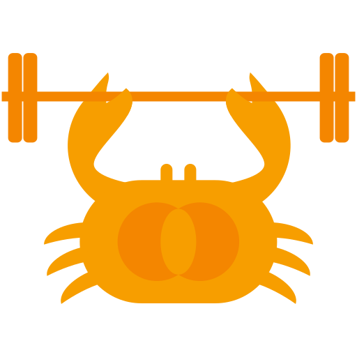

# KRABBE SPORTLICH 

Align your schedules to find the perfect time that works for everyone.
Open-source and licensed under the [GNU GPLv3](./LICENSE).

Krabbe Sportlich is a fork of [Star fit](https://github.com/drinkablebreeze/starbestfit.com) that supports multiple degrees of preference expression (0 to 5 stars) and uses [STAR Voting](https://starvoting.org/star) to automatically calculate the best event time. Tabulation details can be found at the top of [this file](./frontend/src/utils/star.ts).

### Changes from upstream

This repository (krabbe, running at [krabbe.hpi.church](https://krabbe.hpi.church)) builds on Star Fit with the following changes:

- **Calendar extension**: a Manifest V3 Firefox extension in [`browser-extension/`](./browser-extension) reads your CalDAV calendars locally and adds a "Remove calendar conflicts" button to event pages, which marks your busy slots as unavailable. Only busy intervals are handed to the page.
- **Instance accounts**: users can register with a username, display name and password. Logged in users join events as `@username` automatically (guest entry still works) and own the events they create, so they can edit or delete them.
- **Deployment**: container images for the frontend and API, published to ghcr on every commit to `main`, plus a [`compose.yaml`](./compose.yaml) running frontend, API and Postgres. The API can be served under a path prefix (`BASE_PATH`), and the frontend defaults to `/api`.

### ⭐️ Bugs or feature requests

If you find any bugs or have a feature request, please [create an issue](https://github.com/hpi25/krabbe/issues/new/choose).

### Self-hosting

Krabbe Fit is fully open-source, and you can get your own version running by following the [self-hosting guide](./DEPLOYMENT.md).

### Contributing

Visit the [contributing guide](./CONTRIBUTING.md) for info on running locally and submitting pull requests.
